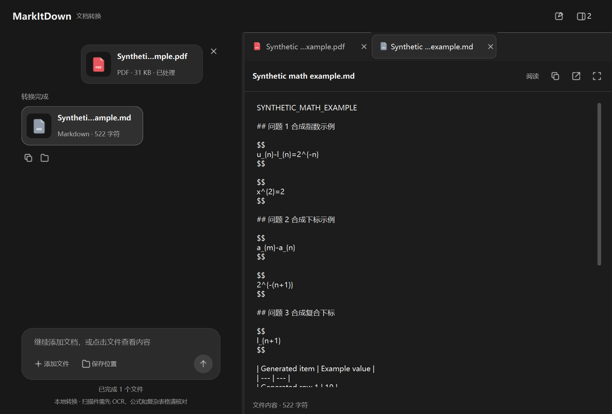

# MarkItDown 桌面端与数学 PDF 识别增强版

把 PDF、Word、PPT、Excel 和文本文件转为 Markdown，使用简洁的中文桌面界面完成添加、预览和批量转换。

本项目由 **Yimaker** 基于微软官方开源项目 [Microsoft MarkItDown](https://github.com/microsoft/markitdown) 改进，增加原生 Windows 桌面界面、文件预览和部分数学 PDF 的文字与版式识别。日常使用在本地完成，不需要 Python、账号或 API Key。本项目不是微软官方桌面客户端。

识别增强针对可选文字的数学 PDF；当前没有图片 OCR，不把扫描图片识别列为已经具备的能力。

**[下载 Windows 发行版](https://github.com/Yimaker/markitdown-desktop-enhanced/releases/latest)** · [使用方法](#使用方法) · [从源码运行](#从源码运行) · [隐私与安全](#隐私与安全)


## 功能

- **添加与批量转换**：点击添加或拖入文件，自动跳过重复项，显示每份文件的状态。
- **原文件与结果对照**：点击文件卡片打开侧边预览；PDF 支持翻页、缩放，Markdown 支持原文与阅读视图。
- **数学 PDF 增强**：依据可选文字的字体、位置和真实分数线，恢复部分上下标、指数、分数、表格与标题。
- **保存与复制**：结果为 UTF-8 `.md`，可以复制全文、打开文件或结果目录。
- **原文件保护**：原文件不变，同名结果自动编号，转换失败不会写出伪成功结果。
- **后台处理**：转换期间界面保持响应，单个文件失败不影响其余文件，可重试。



截图中的文档由测试代码生成，不含真实个人资料。数学输出使用 LaTeX 语法，截图展示的是可复制的原文。

## 支持格式

| 类型 | 扩展名 | 说明 |
| --- | --- | --- |
| PDF | `.pdf` | 提取文字；符合条件的数学 PDF 使用增强解析 |
| Word | `.docx` | 提取正文、标题与表格 |
| PowerPoint | `.pptx` | 提取幻灯片文字等可解析内容 |
| Excel | `.xlsx`、`.xls` | 将表格内容整理为 Markdown |
| 网页文件 | `.html`、`.htm` | 转换用户选中的本地 HTML 文件 |
| 文本与结构化数据 | `.txt`、`.md`、`.csv`、`.json`、`.xml` | 提取并整理可读文本 |

旧版 `.doc`、`.ppt` 不在当前支持范围内，请先另存为 `.docx` 或 `.pptx`。

## 下载与系统要求

前往 [Releases](https://github.com/Yimaker/markitdown-desktop-enhanced/releases/latest)，选择：

- **`MarkItDown-Enhanced.exe`**：独立程序，下载后双击运行。
- **`MarkItDown-Enhanced-Windows-x64.zip`**：完整便携包，含 EXE、使用说明、验证摘要和第三方许可，推荐下载这一份。
- **`SHA256.txt`**：文件校验值。

发行程序面向 **Windows 10/11 x64**，当前在 Windows 11 x64 环境验证。首次启动会解压内置组件，可能需要稍等几秒。程序尚未代码签名；请从本仓库的 Releases 获取文件，不要为运行程序关闭系统安全防护。

如果要修改源码，克隆仓库即可；无需将大体积 EXE 放进源码仓库。

## 使用方法

1. 双击 `MarkItDown-Enhanced.exe`。
2. 点击“添加文件”，或把文档拖入窗口，可一次添加多份。
3. 点击“保存位置”，选择结果目录。
4. 点击底部蓝色转换按钮，等待各项显示完成。
5. 点击原文件或结果卡片查看预览，也可以复制 Markdown、打开结果目录。

例如，`报告.pdf` 会生成 `报告.md`。已有同名结果时，继续生成 `报告 (2).md` 等文件。

## 数学与排版的限制

增强解析适合 **可选文字、可识别数学字体、分数线和表格边框清楚的 PDF**。

可恢复的示例包括：

```latex
u_{n}-l_{n}=2^{-n}
x^{2}=2
2^{-(n+1)}
\frac{u_{n}-l_{n}}{2}
```

扫描件、字体解码失败、多层嵌套分数、矩阵和复杂表格仍需人工核对。当前没有 OCR，也不保证任意 PDF 的全部公式都能正确恢复。

Markdown 的阅读视图不完整排版 LaTeX；需要排版公式时，请使用支持数学语法的阅读器。转换重点是文字与结构，不能完整复刻原 PDF 的页面外观。

## 从源码运行

开发环境：Windows x64、Python 3.12。以下示例使用 [uv](https://docs.astral.sh/uv/)。

```powershell
git clone https://github.com/Yimaker/markitdown-desktop-enhanced.git
cd markitdown-desktop-enhanced

uv venv .venv --python 3.12
uv pip install --python .venv/Scripts/python.exe -r requirements-lock.txt
.\.venv\Scripts\python.exe src\launcher.py
```

## 构建 EXE

```powershell
.\.venv\Scripts\pyinstaller.exe --noconfirm --distpath dist --workpath build MarkItDown.spec
```

产物位于 `dist/MarkItDown-Enhanced.exe`，内含 Python、Qt、MarkItDown 和所需模型/运行库。

打包脚本过滤 `direct_url.json`，避免将开发者的本机安装路径写入公开发行文件。请保留 spec 中对 Windows 系统 ICU/UCRT 库的过滤，避免收集外部工具目录中的不兼容 DLL。

## 测试

```powershell
uv pip install --python .venv/Scripts/python.exe -r requirements-test.txt
.\.venv\Scripts\python.exe prepare_verification.py qa
.\dist\MarkItDown-Enhanced.exe --verify qa
```

测试文档全部由代码生成，**不会自动读取电脑中的个人文档**。数学样例使用 Windows 自带的 Cambria Math 字体，仓库不分发字体文件。

当前发行 EXE 通过 **73 项检查**，覆盖五种常用文档转换、数学语法、原生 PDF 预览、中文/空格路径、重复命名、失败隔离与重试、后台响应及外部资源阻止。

测试采用 Qt 程序化输入和窗口截图，并非人工鼠标测试；测试期间禁用 Python socket，不代表对整台电脑做了断网验证。

## 隐私与安全

- 日常转换仅启用本地文档转换器，不使用云服务、第三方转换插件或遥测。
- Markdown 预览不主动加载外部图片，不自动跟随文档链接。
- 公开内容不包含个人报告、真实姓名/学号、聊天记录、转换结果、私人凭据或本机安装来源。
- 本地设置可能保存结果目录，本地错误日志可能包含文件路径。这些数据不由应用上传，也不应作为反馈附件直接公开。
- 发布候选已进行 Gitleaks 与 detect-secrets 本地扫描及个人信息核对。GitGuardian 在线扫描未完成，不将本地扫描描述成 GitGuardian 通过。

扫描结论只对应已检查的发布文件，不能保证零风险，也不覆盖未来改动。详细边界见 [SECURITY.md](SECURITY.md)。

反馈问题时，优先提供文件格式、软件版本、经过脱敏的错误信息，以及可复现的合成样例。不要在公开 Issue 中粘贴 API Key、私人文档或完整本机日志。

## 项目结构

```text
src/                       桌面界面、预览、本地转换与数学 PDF 解析
tests/                     匿名合成文档生成器
vendor/markitdown/          Microsoft MarkItDown 源码快照及许可
docs/images/               经过核对的合成样例界面截图
prepare_verification.py    准备测试输入
MarkItDown.spec            PyInstaller 打包配置
requirements-lock.txt     开发与构建依赖版本
requirements-test.txt     合成测试文档生成依赖
```

## 许可与致谢

原创桌面界面和增强代码采用 [MIT License](LICENSE)。

本项目基于 Microsoft MarkItDown 0.1.8，上游源码快照对应提交 `4cc9fa1`。上游代码继续遵循其 [MIT 许可](vendor/markitdown/LICENSE) 与 [第三方声明](vendor/markitdown/ThirdPartyNotices.md)。

PySide6/Qt、PyInstaller 和其他组件保留各自许可，详情见发行便携包中的开源许可资料。项目 MIT 许可不替代第三方许可。上游公开作者署名和维护者邮箱按许可要求保留。
