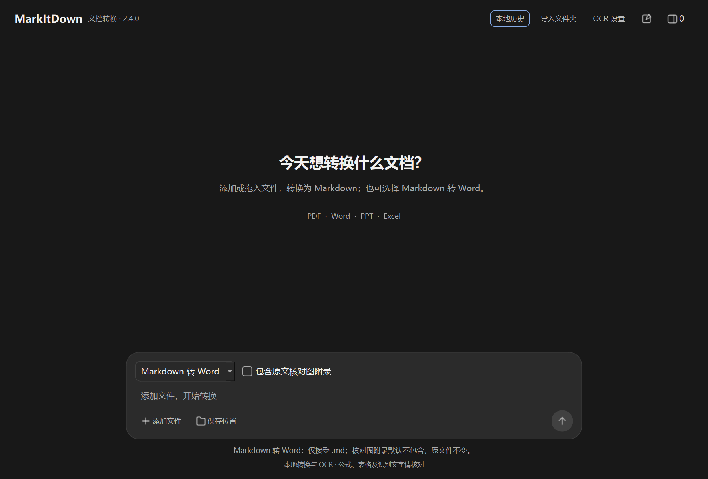
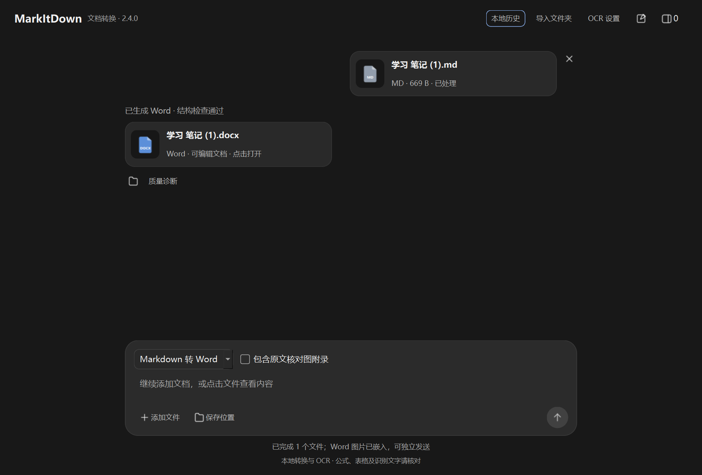

# MarkItDown 桌面端与文档识别增强版

**文档转 Markdown，Markdown 转 Word。** 支持中文桌面界面、批量转换、文件预览、数学内容处理和 Windows 本地 OCR。

由 **Yimaker** 基于微软官方开源项目 [Microsoft MarkItDown](https://github.com/microsoft/markitdown) 改进。Markdown 转 Word 使用内置 [Pandoc](https://pandoc.org/)。这是社区桌面端改进项目，普通使用不需要安装 Python 或 Pandoc，不需要账号或 API Key。

**[下载 Windows 发行版](https://github.com/Yimaker/markitdown-desktop-enhanced/releases/latest)** · [Markdown 转 Word](#markdown-转-word) · [源码构建](#源码构建) · [隐私与安全](#隐私与安全)



## 2.4.0 新增：Markdown 转 Word

- `.md → .docx`，生成可编辑的正文、标题、列表、表格、超链接和代码。
- 支持 `$…$`、`$$…$$` 数学分隔符，支持范围内的公式转换为 Word 原生 **OMML**。
- 中文 A4 模板，通过真正的 Word 样式统一字体、标题、行距与表格。
- 本地位图嵌入 Word，相对路径以 Markdown 所在目录为基准，图片等比例限制在页面可用宽度内。
- “包含原文核对图附录”默认关闭，仅影响输出 Word；正文图片和后续章节保留。
- 完整性检查通过后才发布结果，同名自动编号；不支持的公式保留原文，并提示核对。



截图与公开测试均使用合成资料，不包含个人报告。

## 已有功能

- 添加、拖入或递归导入文件夹，自动跳过重复项，支持批量转换。
- 文档原文与 Markdown 侧边预览，PDF 翻页/缩放、原页与提取文字对照。
- 部分可选文字数学 PDF 的上下标、指数、分数、表格和标题恢复；Markdown 数学预览。
- Windows 本地图片 OCR，以及 PDF 的自动/指定页 OCR；依赖已安装的系统 OCR 语言。
- 提取和保存 Office/PDF 的可导出资产，生成来源页说明与质量诊断。
- 长文本分页预览、全文搜索、编辑并另存副本；本地转换历史搜索。
- 独立转换进程、取消、失败隔离与重试、转换过程中追加文件；保护原文件和既有结果。

## 格式支持

| 方向 | 文件 | 说明 |
| --- | --- | --- |
| 文档 → Markdown | PDF、DOCX、PPTX、XLSX、XLS | 提取文本及支持的结构/资产 |
| 文档 → Markdown | HTML/HTM、TXT、MD、CSV、JSON、XML、EPUB | 处理用户选中的本地文件 |
| 图片 → Markdown | PNG、JPEG、BMP、TIFF、WebP | Windows 本地 OCR，识别结果需核对 |
| Markdown → Word | UTF-8 `.md` | 内置 Pandoc 3.12.1 与中文 Word 模板 |

旧版 `.doc`、`.ppt` 不自动调用 Office 转换，请先手动另存为 `.docx`、`.pptx`。图片 OCR 不保证数学公式、表格结构或全部文字正确。

## 下载和使用

前往 [Releases](https://github.com/Yimaker/markitdown-desktop-enhanced/releases/latest)：

- **`MarkItDown-Enhanced-Windows-x64.zip`**：推荐。含程序、说明、验证摘要和第三方许可。
- **`MarkItDown-Enhanced.exe`**：独立 EXE，可直接双击。
- **`MarkItDown-Enhanced-Source.zip`**：公开源码清单的打包。
- **`SHA256.txt`**：下载文件校验值。

面向 Windows 10/11 x64，已在当前 Windows 11 x64 环境验证。首次启动需要解压内置组件，可能稍等几秒。程序尚未代码签名；请从本仓库 Releases 获取文件，不要为运行程序关闭安全防护。

### 文档转 Markdown

1. 双击程序，选择“文档转 Markdown”。
2. 添加或拖入文件，选择保存位置。
3. 按需要设置 OCR，点击蓝色转换按钮。
4. 点击文件卡片预览、复制或打开结果，查看质量诊断。

## Markdown 转 Word

1. 在下方选择“Markdown 转 Word”。
2. 添加 UTF-8 `.md` 文件，选择保存位置。
3. 按需要勾选“包含原文核对图附录”，默认不勾选。
4. 点击转换按钮，完成后点击 Word 结果卡片，用默认应用打开。

生成同名 `.docx`，同名冲突时使用 ` (2)`、` (3)` 等后缀。图片实际嵌入，Word 文件可独立发送。无需安装 Microsoft Word 即可转换，编辑结果则需兼容的 Word 文档编辑器。

### 方言、公式和图片边界

使用 Pandoc Markdown，启用 `$…$` 与 `$$…$$` 数学语法，不启用 `\(...\)`、`\[...\]` 或自定义 LaTeX 宏。公式和普通文本/代码分别处理；普通货币和代码中的符号不通过全局替换来修订。

支持范围内的表达式生成原生 OMML。不支持的公式保留原文并产生警告；“已生成 Word · 结构检查通过”仅表示结构核验，不等于全部数学语义或页面布局都经过人工检查。

仅嵌入本地位图。含空格的地址可写为 `.png>)`。不自动下载远程图片，不嵌入 UNC 网络图片或 file/data URI；SVG 等矢量格式暂不支持。动图/多帧图片只处理首帧。普通网页超链接保留，原始 HTML 不执行。

只排除真正的二级标题“原文资产与核对图”及其下属内容，遇到后续同级或更高级标题即停止排除；不会粗暴删除后续章节。程序不改写源 Markdown 或图片。

### 排版限制

模板采用 A4、合理页边距、中文正文和分级标题，表格与公式保留可编辑结构；不精确还原原 PDF 的分页或页面外观。

扫描件、字体解码异常、复杂/嵌套公式、矩阵、极宽表格和长代码仍需核对。Windows OCR 不是数学 OCR。数学预览与 Word 公式转换使用不同引擎，不能保证所有表达式在两者中均兼容。

## 源码构建

Windows x64、Python 3.12。以下示例使用 [uv](https://docs.astral.sh/uv/)：

```powershell
git clone https://github.com/Yimaker/markitdown-desktop-enhanced.git
cd markitdown-desktop-enhanced
uv venv .venv --python 3.12
uv pip install --python .venv/Scripts/python.exe -r requirements-lock.txt

# 从固定官方版本准备 Pandoc，自动校验下载归档和实际二进制
.\.venv\Scripts\python.exe scripts\prepare_pandoc.py
.\.venv\Scripts\python.exe src\launcher.py

# 独立 EXE
.\.venv\Scripts\pyinstaller.exe --noconfirm --distpath dist --workpath build MarkItDown.spec
```

产物位于 `dist/MarkItDown-Enhanced.exe`。运行版已内置 Pandoc 和依赖，普通用户不需要执行构建命令或联网下载。

源码 Git 仓库不保存大体积 Pandoc EXE、个人文档、转换资产、历史数据库和日志。必要的匿名 `reference.docx` 模板明确列入源码。打包过滤 `direct_url.json`，不携带开发者本机安装路径。

## 公开测试

```powershell
uv pip install --python .venv/Scripts/python.exe -r requirements-test.txt
.\.venv\Scripts\python.exe prepare_verification.py qa
.\dist\MarkItDown-Enhanced.exe --verify qa
.\dist\MarkItDown-Enhanced.exe --verify-word word-qa
```

隐私整理后的实际 EXE 通过 **86 项原有综合检查**与 **17 项新增 Word 边界检查**，测试输入由代码生成，不读取使用者的个人报告。验证包含文档转换、公式/图片/表格、中文/空格/括号路径、同名不覆盖、缺图与远程路径、警告、附录开关、搜索和后台进程等路径。

测试使用 Qt 程序化操作与真实转换，不宣称人工鼠标验证、所有文件兼容或在另一台干净机器上测试通过。

## 隐私与安全

- 默认只使用本地转换、Windows OCR 和内置 Pandoc，不需要 API Key，不自动上传输入或结果。
- Markdown 预览不自动加载外部图片或跟随文档链接；Word 导出拒绝远程图片等未支持来源。
- **本地历史会保存源/结果路径、时间、状态和完整转换文字**，位于 `%LOCALAPPDATA%/MarkItDown/history.sqlite3`；它是本地全文搜索的索引，不是云服务。
- 结果旁的 `.diagnostics.json` 可能包含原文件路径、原始公式、图像引用及提示；本地错误日志也可能含路径。
- 上述历史、诊断、日志、转换资产、个人报告和原始测试记录均不随源码或发行附件公开。分享结果或反馈问题时，请自行核对要分享的诊断与附件。
- 发布候选采用 Gitleaks、detect-secrets 本地扫描，并核对模板属性和 EXE 内部内容；不将其描述为 GitGuardian 服务端通过。

扫描只对应已检查文件，不能保证零风险或覆盖未来改动。完整边界见 [SECURITY.md](SECURITY.md)。公开 Issue 请使用脱敏错误信息与合成样例，不要上传私人报告、凭据或整份本地日志。

## 许可与致谢

原创界面与增强代码采用 [MIT License](LICENSE)，署名 **Yimaker**。

微软 MarkItDown 0.1.8 源码快照对应 `4cc9fa1`，保留上游 MIT、第三方声明及公开作者署名。Pandoc 3.12.1 作为独立程序调用，保留其许可证、版权资料和对应源码链接；项目 MIT 不替代 Pandoc 或其他组件的许可。

详见 [THIRD_PARTY.md](THIRD_PARTY.md) 和便携包的开源许可资料。
